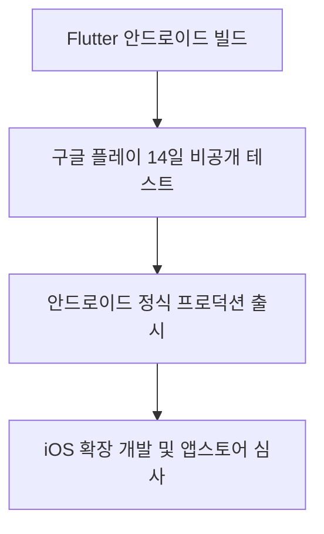

# [문서 03] 안드로이드 퍼스트 롤아웃 & 멀티 AI 오케스트레이션 전략

* **핵심 전략:** 안드로이드 14일 테스트 검증 후 iOS 확장 + AI 제공사는 Claude 하나로 통일하고 작업별로 모델 등급만 나눔.

---

## 1. 안드로이드 퍼스트 롤아웃 파이프라인

* **14일 비공개 테스트 통과 조건:** 2023년 11월 13일 이후 만든 개인 개발자 계정은 테스터 최소 12명이 14일간 연속으로 옵트인된 비공개 테스트를 거쳐야 프로덕션 출시를 신청할 수 있습니다. (도입 당시 20명이었다가 12명으로 완화됨. 조직 계정은 이 요건이 적용되지 않음. 착수 직전 Play Console 고객센터에서 최신 기준을 다시 확인.)
* **라이선스 테스터(License Testing):** 실제 결제 과금 없이 인앱결제(IAP) 정상 동작 루프 검증.

---

## 2. 작업별 최적 AI 모델 오케스트레이션

| 단계 | 특화 엔진 | 선정 이유 및 경제성 |
| :--- | :--- | :--- |
| **1. 카톡 파싱 & 어미 통계** | **온디바이스 Regex + Kiwi** | 비용 0원, 지연 0초, 단톡방 화자 필터링 |
| **2. JEV (시맨틱 KV 추출)** | **Claude Haiku 5.5 (구조화 출력)** | JSON 스키마를 지정하는 구조화 출력 지원. 대량 처리라 가벼운 모델 사용 |
| **3. 실시간 감정/위험 감지** | **온디바이스 룰베이스 필터 + Claude Haiku 5.5 2차 분류** | 1차 키워드 필터는 지연 0ms로 명백한 신호를 즉시 차단. 돌려 말하는 표현은 키워드로 놓치기 쉬우므로, 응답 생성 전에 서버에서 위험도 분류를 한 번 더 거침 |
| **4. 1인칭 페르소나 감성 대화** | **Claude Sonnet 5.5** | 서비스의 핵심 경험이므로 상위 모델 사용. 원가가 부담되면 Haiku 5.5와 블라인드 비교 후 결정 |
| **5. 고인 음성 복원 (Phase 2)** | **Supertone(수퍼톤) / ElevenLabs** | 한국어 특유의 억양/방언 감정 복원 |

> 모델은 주기적으로 단종됩니다(예: 기획 초안의 Claude 3.5 Haiku는 2026년 2월 서비스 종료). 모델 ID는 서버 환경변수로만 관리하고, Anthropic 모델 지원 종료 공지를 분기마다 확인합니다.
